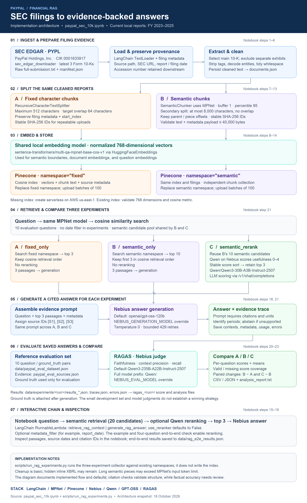

# PayPal SEC Financial RAG

A notebook-based retrieval-augmented generation (RAG) pipeline for answering questions about PayPal Holdings, Inc. using SEC Form 10-K filings. It compares fixed and semantic chunking, adds optional LLM reranking, generates answers with source citations, and evaluates saved answers with RAGAS.

The local filing manifest covers fiscal years **2023–2025**. The downloader selects the latest three available 10-K filings by default, so future downloads may cover different years.

## Architecture



Open the [HTML architecture diagram](paypal_sec_rag_pipeline_architecture.html) in a browser for download and print options, or use the [SVG version](paypal_sec_rag_pipeline_architecture.svg).

```text
SEC EDGAR → raw submissions + manifest → main 10-K extraction → cleaned documents
                                                               │
                             ┌─────────────────────────────────┴─────────────┐
                             ▼                                               ▼
                       Fixed chunks                                   Semantic chunks
                             │                                               │
                             └────────────── MPNet embeddings ───────────────┘
                                                  │
                                Pinecone: fixed / semantic namespaces
                                                  │
Question → MPNet query embedding → retrieval → optional Qwen reranking → top 3
                                                  │
                                  Nebius generation → cited answer
                                                  │
                          Saved answers + references → RAGAS → comparison
```

## Technology and defaults

| Component | Implementation |
| --- | --- |
| Source | PayPal (`PYPL`), CIK `0001633917`, SEC Form 10-K |
| Download and loading | `sec_edgar_downloader`, LangChain `TextLoader` |
| Fixed chunking | `RecursiveCharacterTextSplitter`: maximum 512 **characters**, target overlap 64 characters |
| Semantic chunking | `SemanticChunker`: percentile threshold 95, buffer size 1; secondary split at 8,000 characters with no overlap |
| Embeddings | `sentence-transformers/multi-qa-mpnet-base-cos-v1`, normalized 768-dimensional vectors, run locally |
| Vector storage | Pinecone cosine index with `fixed` and `semantic` namespaces |
| Reranker | `Qwen/Qwen3-30B-A3B-Instruct-2507` on Nebius; LLM usefulness scores from 0 to 4 |
| Answer generation | Default `openai/gpt-oss-120b`, hosted on Nebius |
| Evaluation | RAGAS 0.3.9; default judge `Qwen/Qwen3-235B-A22B-Instruct-2507` on Nebius |

Reranking uses Nebius chat completions, rather than a dedicated rerank endpoint. Answers and evaluation use Nebius credentials; an OpenAI API key is not required.

## Project structure

```text
Financial_RAG/
├── README.md
├── paypal_sec_10k.ipynb                 # Main ingestion, RAG and evaluation workflow
├── paypal_sec_rag_pipeline_architecture.html
├── paypal_sec_rag_pipeline_architecture.png
├── paypal_sec_rag_pipeline_architecture.svg
├── scripts/
│   ├── run_rag_experiments.py          # Run experiments against existing namespaces
│   └── build_pipeline_architecture.py  # Regenerate the architecture artifacts
└── data/
    ├── paypal_eval_dataset.json        # 10 question/reference-answer pairs
    ├── paypal_eval_sources.json        # Supporting evidence and source metadata
    ├── rag_e2e_results.json            # End-to-end answers and structural checks
    ├── experiments/                    # Generated locally; excluded from Git
    └── sec_edgar/sec-edgar-filings/PYPL/10-K/
        ├── manifest.json              # Selected filing metadata
        ├── documents.json             # Cleaned document text and metadata
        └── <accession>/full-submission.txt
```

## Local setup

Use a Python environment with Jupyter or a VS Code notebook kernel. From the project root, a virtual environment can be prepared with:

```bash
python3 -m venv .venv
source .venv/bin/activate
python -m pip install jupyterlab ipykernel
python -m jupyter lab
```

On Windows, activate with `.venv\Scripts\activate` instead. Open [paypal_sec_10k.ipynb](paypal_sec_10k.ipynb), select the environment's kernel, and run its initial `%pip install` cell. The notebook contains the dependency constraints; RAGAS has an additional installation cell in Step 22. Restart the kernel if prompted and rerun the required setup cells.

Create or update `.env` in the project root with your own values:

```dotenv
SEC_COMPANY_NAME=Your name or organization
SEC_EMAIL=you@example.com
PINECONE_API_KEY=your-pinecone-api-key
PINECONE_INDEX_NAME=paypal-mpnet
NEBIUS_API_KEY=your-nebius-api-key

# Optional model overrides
NEBIUS_GENERATION_MODEL=openai/gpt-oss-120b
NEBIUS_EVAL_MODEL=Qwen/Qwen3-235B-A22B-Instruct-2507
```

Use real SEC contact information. `.env` is excluded by the existing `.gitignore`; keep credentials out of notebook cells and outputs. Existing environment variables take precedence over `.env` values.

SEC downloading needs contact information but no API key. Pinecone operations require Pinecone credentials. Generation, reranking, and evaluation require Nebius access and consume inference credits. The first embedding-model setup downloads MPNet; a CPU runtime is sufficient.

## Run the notebook

Run with the project root as the kernel working directory. Review each stage before execution, especially the namespace replacement cells.

| Steps | Work performed |
| --- | --- |
| 1–6 | Configure and download filings, build the manifest, load text, extract the main 10-K, clean and save documents |
| 7–10 | Create fixed chunks, configure MPNet/Pinecone, assign stable IDs, replace and upload the `fixed` namespace |
| 11–13 | Create semantic chunks, enforce size and metadata limits, replace and upload the `semantic` namespace |
| 14–17 | Compare retrieval from both namespaces and inspect Qwen reranking |
| 18–19 | Run the interactive RAG chain and four end-to-end generation checks |
| 20–21 | Define the ten-question development dataset and collect three experiment result sets |
| 22–23 | Evaluate saved answers using RAGAS and produce comparison reports |

The default download configuration is `MAX_FILINGS = 3`, with amendments excluded. Optional `START_DATE` and `END_DATE` filter **filing dates**, not fiscal years. The manifest selects the eligible files from the local download directory.

If the named Pinecone index does not exist, the notebook creates a 768-dimensional cosine index on AWS `us-east-1`. An existing index must have matching dimensions and metric. Both namespaces should contain the same filings for comparison.

**Steps 10 and 13 delete all records in their respective namespaces before uploading replacements.** They use stable chunk IDs and batches of 100. Avoid simultaneous uploads to the same namespace.

### Ask a question

After the semantic index and Step 18 chain setup are ready:

```python
result = rag_chain.invoke({
    "question": "What were PayPal's total net revenues in 2024?",
    "use_reranker": True,
    "metadata_filter": None,
})
print(result["answer"])
sources = result["sources"]
```

The interactive chain retrieves up to **20 semantic candidates**, then selects three passages with optional reranking. `use_reranker` defaults to `False`. The prompt requests citations such as `[S1]`, preserves financial units and reporting periods, and instructs the model to acknowledge insufficient evidence.

To restrict retrieval, pass a filter such as `{"report_date": {"$eq": "2024-12-31"}}`. A later filing can also contain earlier-year figures, so use date filters deliberately.

### Google Colab

Upload the notebook to Colab and run its installation and configuration cells. The configuration prompts for missing SEC contact information; subsequent setup cells prompt for Pinecone settings. Nebius calls require `NEBIUS_API_KEY` in the runtime environment or a runtime `.env` file. Local files are not automatically available in Colab, and runtime files are temporary; download results before the runtime is deleted.

## Compare the three experiments

| Experiment | Retrieval and selection |
| --- | --- |
| A: `fixed_only` | Retrieve top 3 fixed chunks; no reranking |
| B: `semantic_only` | Retrieve 10 semantic candidates; select the first 3 in cosine order |
| C: `semantic_rerank` | Reuse B's 10 semantic candidates; Qwen reranks and selects top 3 |

All three use the same ten questions, generation function, prompt, and configured answer model. The collector uses no metadata date filter. Its **10-candidate** semantic pool is separate from the interactive chain's 20-candidate default.

After completing index setup and both uploads, run the collector independently using the same environment as the notebook:

```bash
python scripts/run_rag_experiments.py
```

This script reads existing Pinecone records and executes selected notebook cells. It does not download filings or modify the index. Both namespaces must be populated, and MPNet must already be cached because the script uses `local_files_only=True` on CPU. It depends on specific notebook cell IDs; preserve those IDs or update the script when restructuring the notebook.

Each run creates `data/experiments/<UTC-timestamp>/` containing:

- `config.json`: models, retrieval settings, and question count.
- `results_fixed_only.json`, `results_semantic_only.json`, `results_semantic_rerank.json`: question, answer, contexts, and ground truth.
- `traces.json`: source metadata, candidates, generation usage, and timing.
- `errors.json`: recorded failures, excluded from the result arrays.

Collection makes up to 30 generation calls and 10 reranking calls, plus retries. Ground truth is attached **after generation** and is not sent to retrieval, reranking, or the answer model.

## Evaluate and inspect results

Experiment outputs are excluded from Git. Collect a run first, or supply your own saved results. Use the Step 21 reload cell to load saved experiment results without regenerating answers. Change its `experiment_output_dir` to the run you want to evaluate; the notebook currently points to a specific local run that is not included in the repository.

Run Step 22's installation, setup, and evaluation cells. RAGAS evaluates the saved answers and contexts without querying Pinecone or regenerating answers, but it makes paid Nebius judge calls.

| Metric | What it measures |
| --- | --- |
| Faithfulness | Whether answer claims are supported by retrieved passages |
| Context precision | Whether useful passages rank ahead of irrelevant passages, relative to the reference answer |
| Context recall | Whether the retrieved passages support the reference answer's claims |

Outputs are saved under `data/experiments/<run>/ragas_<timestamp>/`: per-question score CSV/JSON files, summary files, and evaluation configuration. Step 23 adds `comparison.csv`, `score_coverage.csv`, `paired_comparison.csv`, and `analysis_report.txt`.

Scores range from 0 to 1. Missing or invalid scores remain missing and are excluded from means. Compare coverage alongside averages; paired comparisons use only questions with valid scores in both experiments.

## Rebuild the architecture diagram

```bash
python -m pip install Pillow
python scripts/build_pipeline_architecture.py
```

The script creates standalone HTML, SVG, and a 2800 × 4580 PNG in the project root without network calls. PNG rendering requires Arial or DejaVu Sans in one of the font locations checked by the script. Diagram content is maintained explicitly in the script; notebook changes do not automatically update it.

## Limitations and troubleshooting

- **Basic text extraction:** Cleanup strips markup and normalizes whitespace; it does not reconstruct financial tables, and hidden inline XBRL content may remain.
- **Embedding truncation:** The 8,000-character semantic-piece limit controls storage size, not MPNet's input token limit. Long pieces may be truncated during embedding.
- **Evaluation scope:** The ten-question dataset includes development questions and is not a held-out benchmark. Model-judged scores and citation-ID checks do not establish factual accuracy or completeness.
- **SEC access errors:** Check the supplied contact information and network access. Hosted environments may encounter SEC HTTP 403 responses.
- **Index errors:** Check the configured index's dimensions, cosine metric, and namespace contents. Pinecone updates are eventually consistent; the notebook waits for expected vector counts.
- **Missing cached model:** Run the notebook's MPNet setup with download access before using the standalone experiment runner.
- **Nebius failures:** Check credentials, available credits, and configured model access. The generation helper bounds retries for HTTP 429 responses; experiment errors are recorded separately.

Inspect the retrieved passages, periods, units, and citations before relying on an answer.
